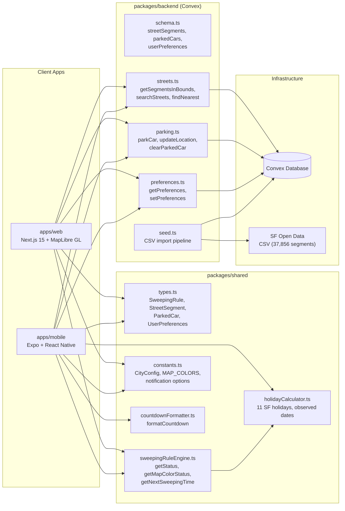
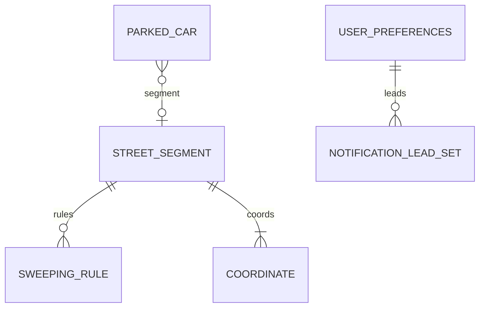

# Data Architecture -- easystreet-monorepo

> Auto-generated: 2026-02-09 | Source: Convex schema + shared types

---

## Entity-Relationship Diagram

```mermaid
erDiagram
    STREET_SEGMENT {
        string segmentId PK
        string cnn
        string streetName
        string blockSide
        string limits
    }
    SWEEPING_RULE {
        number dayOfWeek
        string startTime
        string endTime
        boolean applyOnHolidays
    }
    COORDINATE {
        number latitude
        number longitude
    }
    BOUNDS {
        number latMin
        number latMax
        number lngMin
        number lngMax
    }
    WEEKS_OF_MONTH {
        number weekNumber
    }
    PARKED_CAR {
        string deviceId PK
        number latitude
        number longitude
        string streetName
        number parkedAt
        number notificationLeadMinutes
        string segmentId FK
    }
    USER_PREFERENCES {
        string deviceId PK
        boolean hasSeenDisclaimer
        number notificationLeadMinutes
        string activeCityCode
    }
    NOTIFICATION_LEAD_SET {
        number leadMinutes
    }
    SWEEPING_STATUS {
        string type
        string streetName
    }
    CITY_CONFIG {
        string code PK
        string name
    }
    HOLIDAY {
        date observedDate
        string name
    }
    MAP_COLOR_STATUS {
        string color
    }

    STREET_SEGMENT ||--o{ SWEEPING_RULE : "has rules"
    STREET_SEGMENT ||--|{ COORDINATE : "has coordinates"
    STREET_SEGMENT ||--|| BOUNDS : "has bounds"
    SWEEPING_RULE ||--o{ WEEKS_OF_MONTH : "applies on weeks"
    PARKED_CAR }o--o| STREET_SEGMENT : "parked at segment"
    USER_PREFERENCES ||--o{ NOTIFICATION_LEAD_SET : "lead times"
    USER_PREFERENCES }o--o| CITY_CONFIG : "active city"
    STREET_SEGMENT ||--|| MAP_COLOR_STATUS : "computed color"
    SWEEPING_RULE ..o{ HOLIDAY : "skipped on holidays"
    STREET_SEGMENT ||--|| SWEEPING_STATUS : "computed status"
```

---

## System Architecture



---

## Minimal Diagram (inline reference)



---

## Key Relationships

| From | To | Cardinality | Notes |
|------|-----|-------------|-------|
| StreetSegment | SweepingRule | 1:N | Embedded array in Convex document |
| StreetSegment | Coordinate | 1:N | LINESTRING geometry from SF CSV |
| StreetSegment | Bounds | 1:1 | Computed bounding box for spatial queries |
| SweepingRule | WeeksOfMonth | 1:N | Empty array = every week |
| ParkedCar | StreetSegment | N:0..1 | Optional FK via segmentId |
| UserPreferences | NotificationLeadSet | 1:N | Multi-alarm notification schedule |
| UserPreferences | CityConfig | N:0..1 | Currently only "sf" |

## Convex Indexes

| Table | Index | Fields | Type |
|-------|-------|--------|------|
| streetSegments | by_segmentId | segmentId | Regular |
| streetSegments | by_streetName | streetName | Regular |
| streetSegments | search_streetName | streetName | Full-text search |
| parkedCars | by_deviceId | deviceId | Regular |
| userPreferences | by_deviceId | deviceId | Regular |

## Data Flow Summary

1. **SF Open Data CSV** (37,856 segments) is parsed by `seed.ts` and batch-inserted into Convex
2. **Clients** query `streets.ts` for segments within the visible map bounding box (capped at 500)
3. **Shared engine** (`sweepingRuleEngine.ts`) computes sweeping status and map colors client-side
4. **Holiday calculator** dynamically generates 11 SF holidays for any year with observed-date shifting
5. **Parking** is device-scoped (no auth) -- one parked car per deviceId, persisted to Convex and local storage (mobile)
6. **Notifications** (mobile only) are scheduled locally via Expo notifications service based on `notificationLeadMinutesSet`
